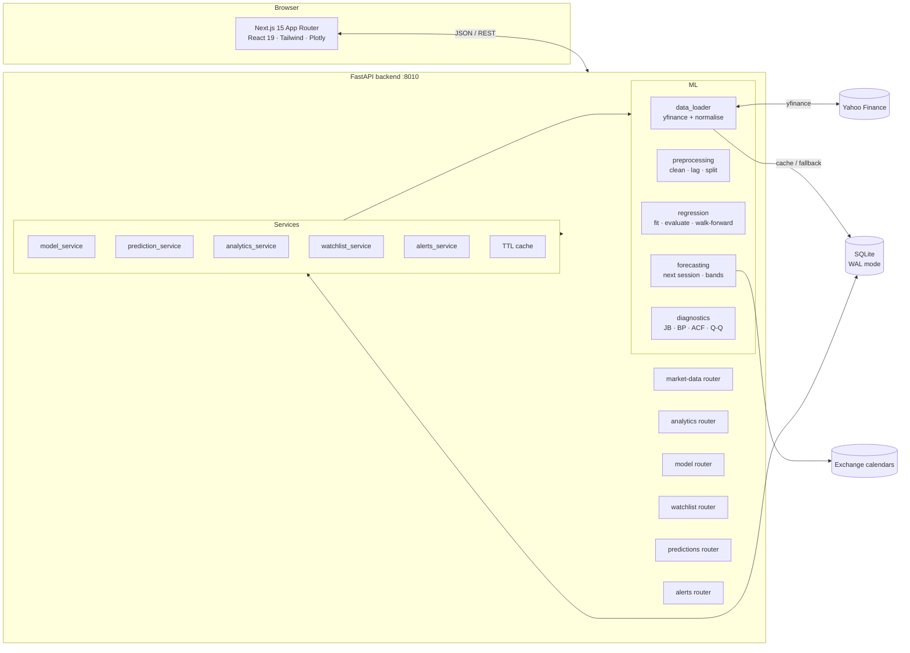

# StockSense AI — Stock Market Analytics & Price Prediction

A full-stack, educational stock analytics platform built on **live Yahoo Finance data**. It pairs a
Next.js/Plotly interface with a FastAPI + scikit-learn backend whose *only* predictive model is a
**Simple Linear Regression** on the previous adjusted close:

> **X** = previous trading day's adjusted close → **Y** = current trading day's adjusted close

Every chart, KPI and sentence in the product is computed from the observations returned by the data
provider for the ticker and date range you select. Nothing is mocked, hardcoded or pre-baked, and no
future price is ever invented.

> Predictions are not investment advice. Yahoo Finance data can be delayed, revised or incomplete.

---

## What is inside

### 14 pages, all wired to live endpoints

| Group | Pages |
| --- | --- |
| Overview | Dashboard |
| Research | Market Explorer · Historical Data & Quality · Trend Analysis · Returns & Volatility · Comparison |
| Machine Learning | Model Lab · Backtesting · Forecast Studio · Residual Diagnostics · Model Insights |
| Monitoring | Watchlist · Prediction Journal & Alerts |
| Reference | Methodology |

Each page ships with interactive Plotly charts, KPI cards, computed plain-language insights, data
source/units labels, and explicit loading / empty / error states.

### The model, exactly as implemented

1. Fetch daily OHLCV from Yahoo Finance with `auto_adjust=True` (true adjusted data).
2. Clean: sort ascending, collapse duplicate dates, drop non-positive or missing closes.
3. Lag: drop the first row, then `X = Close[t-1]`, `Y = Close[t]`.
4. Split **chronologically** at 70% (adjustable 50–90%). No shuffling, ever.
5. Fit `LinearRegression` on the training rows only.
6. Evaluate on the untouched holdout: MAE, MSE, RMSE, R², MAPE, directional accuracy.
7. Score the naive "tomorrow equals today" baseline on the *same* test dates.
8. Refit a separate operational model on **all** observations for forecasting.
9. Walk-forward (expanding window): refit before each test step, predict one step, never look ahead.
10. Diagnostics: Jarque–Bera, Breusch–Pagan, residual ACF with a ±1.96/√n band, Q–Q plot,
    skew/kurtosis, 2.5σ outliers.

A second feature mode `trend` (sequential trading-day index → close) exists for education only and
is labelled as such everywhere it appears. It is never used for forecasting.

### Honest evaluation by design

- The naive persistence baseline is shown next to the model on test MAE/RMSE/R²/MAPE.
- With highly persistent prices the naive benchmark often wins or ties; the UI says so explicitly
  instead of hiding it ("Does not beat naive MAE").
- Train R² vs test R² gap is stated as a measure of overfitting.
- Forecast bands are empirical 5–95% residuals, labelled "not a statistically guaranteed confidence
  interval".
- The journal resolves saved predictions against the next real observation and reports average error.

---

## Architecture



**Backend** — FastAPI, pandas, numpy, scikit-learn, scipy, statsmodels, yfinance, SQLAlchemy 2.x.
SQLite in WAL mode for persistence; the schema (SQLAlchemy models) is portable to PostgreSQL by
changing `STOCKSENSE_DATABASE_URL`.

**Frontend** — Next.js 15 App Router, React 19, TypeScript strict, Tailwind 3, SWR, a lazy-loaded
Plotly build, lucide icons. Dark navy fintech theme with a full light mode and mobile navigation.

### Tables

| Table | Purpose |
| --- | --- |
| `stock_data` | Cleaned daily OHLCV per ticker/date (unique constraint), last retrieval timestamp |
| `model_runs` | Every training run: sample ranges, coefficients, test metrics, baseline MAE, split |
| `prediction_history` | Auditable predictions: input price, coefficients, forecast, resolution vs actual |
| `watchlist` | Tickers tracked by the user |
| `user_alerts` + `alert_events` | In-app alert rules and de-duplicated events |

### Data integrity rules

- Prices are **adjusted**; the UI labels them "Adjusted closing price" and shows exchange/currency.
- If Yahoo Finance fails, the API serves the last stored SQLite rows flagged `stale` with a warning —
  it never fabricates a price.
- 10-minute in-memory TTL cache on price payloads; quote metadata cached for a day.
- All timestamps are UTC ISO strings; the UI formats them for display.
- Errors use consistent JSON: `{"error": {"code", "message"}}` with meaningful 4xx/5xx status codes.

---

## Quick start (local, Windows or Unix)

### 1. Backend — http://127.0.0.1:8010

```bash
cd backend
python -m venv .venv
# Windows
.venv\Scripts\activate
# macOS/Linux
source .venv/bin/activate

pip install -r requirements.txt
uvicorn main:app --host 127.0.0.1 --port 8010 --reload
```

Interactive docs: <http://127.0.0.1:8010/docs> · Health: <http://127.0.0.1:8010/api/health>

The database and its WAL files are created under `backend/data/` on first start.

### 2. Frontend — http://localhost:3000

```bash
cd frontend
npm install
cp .env.example .env.local     # NEXT_PUBLIC_API_URL=http://127.0.0.1:8010
npm run dev
```

> On Windows Git Bash, if `npm` is not found, prefix commands with
> `PATH="/c/Program Files/nodejs:$PATH"` or call `"/c/Program Files/nodejs/npm.cmd"` directly.

### 3. Docker (optional)

```bash
docker compose up --build
```

- Frontend: <http://localhost:3000>
- Backend: <http://127.0.0.1:8010>
- SQLite lives in the named volume `stocksense-data`.
- `NEXT_PUBLIC_API_URL` is compiled into the frontend at build time; change the build arg in
  `docker-compose.yml` if the API is not reachable at `http://127.0.0.1:8010` from your browser.

### Environment variables

| Location | Variable | Default |
| --- | --- | --- |
| backend `.env` | `STOCKSENSE_DATABASE_URL` | `sqlite:///<repo>/backend/data/stocksense.db` |
| | `STOCKSENSE_DEFAULT_TICKER` / `_PERIOD` | `RELIANCE.NS` / `2y` |
| | `STOCKSENSE_CACHE_TTL_SECONDS` | `600` |
| | `STOCKSENSE_CORS_ORIGINS` | `http://localhost:3000,http://127.0.0.1:3000` |
| | `STOCKSENSE_ALPHA_VANTAGE_API_KEY` / `_FINNHUB_API_KEY` | empty — features work without keys |
| frontend `.env.local` | `NEXT_PUBLIC_API_URL` | `http://127.0.0.1:8010` |

All backend variables use the `STOCKSENSE_` prefix and are optional. See
[`backend/.env.example`](backend/.env.example).

---

## REST API

| Method | Path | Purpose |
| --- | --- | --- |
| GET | `/api/health` | DB check, yfinance version, cache size, last fetch state |
| GET | `/api/market-data` | OHLCV + metadata + summary for a ticker/period/custom range |
| GET | `/api/market-data/summary` | Price KPIs, 52-week range, volatility, volume series |
| GET | `/api/market-data/quality` | Raw → cleaned audit |
| GET | `/api/market-data/dataset` | Paginated, searchable, sortable observation table |
| GET | `/api/market-data/dataset.csv` | Cleaned CSV download |
| POST | `/api/market-data/refresh` | Force a fresh provider fetch |
| GET | `/api/market-data/search` | Yahoo symbol search |
| GET | `/api/market-data/periods` | Supported periods and intervals |
| GET | `/api/market-data/featured` | Cached live quotes for 12 NSE/NASDAQ companies behind the landing board |
| GET | `/api/dashboard` | Aggregated dashboard payload (model, forecast, charts) |
| GET | `/api/analytics/trend` | Moving averages, rolling extremes, trend labels |
| GET | `/api/analytics/returns` | Returns, drawdowns, volatility, histograms |
| GET | `/api/analytics/volatility` | Returns payload focused on risk |
| GET | `/api/analytics/comparison` | 2–5 tickers: normalized performance, correlations, risk/return |
| GET | `/api/analytics/data-quality` | Quality metrics and availability series |
| POST | `/api/model/train` | Fit + evaluate + persist a run |
| GET | `/api/model/metrics` | Train/test/naive metrics without persisting |
| GET | `/api/model/backtest` | Holdout evaluation + computed findings (+ walk-forward) |
| POST | `/api/model/forecast` | Operational forecast, 1–5 recursive steps, empirical band |
| GET | `/api/model/diagnostics` | Residual diagnostic statistics and chart series |
| GET | `/api/model/insights` | Coefficients, worked example, sensitivity, explanations |
| GET | `/api/model/runs` | Stored model runs |
| GET/POST | `/api/watchlist` | List with quotes/analytics · add ticker |
| DELETE | `/api/watchlist/{id}` | Remove ticker |
| GET/POST | `/api/predictions` | Journal with auto-resolution · save a prediction |
| GET | `/api/predictions/{id}` | Single journal record |
| GET/POST | `/api/alerts` | Alert rules · create a rule |
| PATCH/DELETE | `/api/alerts/{id}` | Enable/disable · delete a rule |
| POST | `/api/alerts/evaluate` | Evaluate enabled rules and record events |

Validation is enforced with Pydantic (e.g. split ratio 0.5–0.9, horizon 1–5, alert thresholds > 0).
Invalid symbols return `400 validation_error`; unknown symbols return `404 no_data`; upstream provider
failures return `502 upstream_error`; request-shape errors return `422 request_validation_error`.

---

## Monitoring semantics (honest in-app alerts)

- Alerts are **evaluated on demand** (a "Evaluate now" action on the Journal & Alerts page) or
  whenever the journal is loaded — there is no background daemon pretending to monitor markets.
- Four rule types are supported: price change %, forecast error %, data-refresh failure, and a new
  actual observation being resolved.
- Events are de-duplicated by deterministic keys, so repeated evaluations do not spam the list.
- No email/SMS is sent and nothing is claimed to be sent. The UI states this explicitly.

## Forecast semantics

- One-step forecast: `ŷ = b0 + b1 × latest adjusted close` using the operational refit.
- Horizons 2–5 are labelled **recursive projections**; each predicted price becomes the next input and
  uncertainty compounds.
- Forecast dates come from `pandas_market_calendars` when the exchange is recognised (NSE, NYSE, LSE,
  etc.) and are marked verified; otherwise the next weekday is shown as explicitly unverified.
- The error band is the empirical 5–95% range of holdout residuals, added to the point forecast.

---

## Tests

```bash
cd backend
python -m pytest tests -q
```

64 tests cover:

| Area | Highlights |
| --- | --- |
| Preprocessing | ordering, de-duplication, invalid-price removal, lag construction, chronological split bounds |
| Metrics | hand-computed MAE/MSE/RMSE/MAPE/R², negative R², direction logic, naive-forecast edge case |
| Regression | exact coefficient recovery, test-only evaluation, operational refit, naive baseline wiring, walk-forward |
| Forecasting | calendar vs weekday fallback, band requirements, recursive steps, horizon clamping, no fabricated actuals |
| Diagnostics | minimum-residual guard, statistic/chart completeness, outliers |
| Analytics | returns arithmetic on monotonic windows, quality audit, insufficient-history path |
| Persistence | model runs, prediction save/resolve, journal aggregates, watchlist, alert lifecycle + de-duplication |
| API | health, periods, pagination, CSV export, error mapping, train/metrics, watchlist, predictions, alerts |

No network calls occur during tests: the market-data loader is replaced with deterministic fixtures
(`Y = 2 + 1.0005·X` for exactness, a noisy variant for statistics).

Frontend checks:

```bash
cd frontend
npm run typecheck
npm run build
```

---

## Project structure

```
stocksense-ai/
├─ backend/
│  ├─ api/               # FastAPI routers (market data, analytics, model, watchlist, predictions, alerts)
│  ├─ database/          # SQLAlchemy engine, session, init
│  ├─ ml/                # data_loader · preprocessing · regression_model · evaluation · forecasting · diagnostics
│  ├─ models/            # ORM entities
│  ├─ schemas/           # Pydantic request models
│  ├─ services/          # analytics, dashboard, model, predictions, watchlist, alerts, cache, runtime state
│  ├─ tests/             # pytest suite + fixtures
│  ├─ config.py · utils.py · main.py
│  ├─ requirements.txt · .env.example · Dockerfile
├─ frontend/
│  ├─ app/(app)/         # 14 pages + shared app shell
│  ├─ components/        # charts, UI primitives, dashboard widgets, nav
│  ├─ lib/               # API client, chart theme, types, formatters, ticker context
│  ├─ package.json · .env.example · Dockerfile
├─ docker-compose.yml
└─ README.md
```

---

## Troubleshooting

| Symptom | Cause / fix |
| --- | --- |
| `npm`/`node` not found in Git Bash | Node is installed but not on PATH: `PATH="/c/Program Files/nodejs:$PATH"`. |
| Backend starts, pages show data errors | Check `NEXT_PUBLIC_API_URL` in `frontend/.env.local`, then restart `npm run dev` (value is read at startup). |
| CORS error in the browser | Add the frontend origin to `STOCKSENSE_CORS_ORIGINS` and restart uvicorn. |
| `404 no_data` for a valid symbol | Yahoo Finance occasionally rate-limits or misses symbols; retry, or wait for the cache to expire. |
| Stale data banner | Yahoo returned nothing new; the API served the last stored SQLite rows and flagged them stale. |
| Forecast date marked unverified | The listing's exchange has no configured calendar; the next weekday is used and labelled. |
| `database is locked` | SQLite WAL handles concurrency, but a stuck writer can block; ensure only one backend process writes `backend/data/`. |
| Port 8010 or 3000 busy | Change `--port` / `npm run dev -- -p 3001` and update `NEXT_PUBLIC_API_URL`/CORS accordingly. |
| Docker build fails on Plotly memory | Give Docker Desktop ≥ 4 GB RAM; the Plotly bundle is large but loaded lazily in the browser. |

---

## Limitations (stated plainly)

- One feature only. News, earnings, macro shocks, liquidity and sentiment are unobserved, which is
  exactly where large forecast errors come from.
- Prices are close to a random walk; expect the naive baseline to be competitive, and expect
  directional accuracy near 50%.
- Yahoo Finance history can be revised, delayed or incomplete; it is research data, not
  exchange-grade market data.
- Alerts are in-app and evaluated on demand — there is no background job, email or SMS delivery.
- SQLite is the default store for portability; use PostgreSQL for multi-user or high-concurrency
  deployments (only the connection URL and driver change).

---

## Disclaimer

StockSense AI is an educational project. It does not provide financial advice, brokerage services,
or guarantee any outcome. Predictions are statistical estimates from a deliberately simple model and
must not be used as the basis for investment decisions.
